<!--
      /\_/\
     ( o.o )   you found the source. there are more of us in here.
      > ^ <
-->



<a href="mailto:beni18christopher@gmail.com"><b>email</b></a> &nbsp;/&nbsp; <a href="https://linkedin.com/in/bennish-christopher-89a51733b"><b>linkedin</b></a> &nbsp;/&nbsp; <a href="#flagship"><b>jump to projects</b></a>


How this account learned, read like a training run. The bars are real: every repo, by the month it was created. Each new epoch kicks the loss back up, because something new is being learned.

<a href="https://github.com/Beni-18/google-gdg-devfest-2026"></a> <a href="https://github.com/Beni-18/ED_Monitor"></a>

<a href="https://github.com/Beni-18/DockAssit"></a> <a href="https://github.com/Beni-18/Passione"></a>

<a href="https://github.com/Beni-18/Where_Did_It_Go-"></a> <a href="https://github.com/Beni-18/smart-agri-water-irrigation-ai"></a>


<a href="https://github.com/Beni-18/CoffeeShop_Prediction"></a> <a href="https://github.com/Beni-18/Framingham_Heart_Disease-Predictor-"></a> <a href="https://github.com/Beni-18/SVM_Digit_Predictor"></a> <a href="https://github.com/Beni-18/wine-quality-prediction"></a> <a href="https://github.com/Beni-18/Spam_Maill_Detector"></a> <a href="https://github.com/Beni-18/Mushroom_Classifier"></a> <a href="https://github.com/Beni-18/diabetes-gradient-boosting-streamlit"></a>

<a href="https://github.com/Beni-18/House_Price_Prediction"></a> <a href="https://github.com/Beni-18/Milk_Quality_Predictor"></a> <a href="https://github.com/Beni-18/Mall_Customer_Segmentation"></a> <a href="https://github.com/Beni-18/Lasso_Linear"></a> <a href="https://github.com/Beni-18/Wine_Quality_Predictor"></a> <a href="https://github.com/Beni-18/DBSCAN_Wine"></a> <a href="https://github.com/Beni-18/Logistic_Assesment"></a>

<a href="https://github.com/Beni-18/Breast_Cancer_Identifier"></a> <a href="https://github.com/Beni-18/Heart_Disease_DesicionTree"></a> <a href="https://github.com/Beni-18/Energy_Efficiency_Model"></a> <a href="https://github.com/Beni-18/XGBOOSTING"></a> <a href="https://github.com/Beni-18/Hierarchial_Clustering"></a> <a href="https://github.com/Beni-18/Feature_Selection"></a> <a href="https://github.com/Beni-18/Final_Presentation"></a>

The study notes behind these live in <a href="https://github.com/Beni-18/Data-Scientist">Data-Scientist</a>.


| repo | what it does | built with |
|:--|:--|:--|
| [`FixIt`](https://github.com/Beni-18/FixIt) | Campus maintenance tickets with student, staff and admin roles | Rails 7 · React |
| [`ARtifact`](https://github.com/Beni-18/ARtifact) | Heritage sites and their stories, brought into your space | React · Vite |
| [`emergency-response-agent`](https://github.com/Beni-18/emergency-response-agent) | Multi-agent coordinator that assigns responders to emergencies | Google ADK · Python |
| [`quality-defect-analytics`](https://github.com/Beni-18/quality-defect-analytics) | Manufacturing defects and supplier scorecards, from EDA to forecasting | Python · SQL · scikit-learn |
| [`Cliqtrix`](https://github.com/Beni-18/Cliqtrix) | Audiva, a music recommendation bot for Zoho SalesIQ | Node.js · Zoho SalesIQ |
| [`entertainment-bot-zoho-salesiq`](https://github.com/Beni-18/entertainment-bot-zoho-salesiq) | Movie, event and food recommendations with mood detection | Deluge · OAuth 2.0 · TMDB |
| [`Book-Material-Portal`](https://github.com/Beni-18/Book-Material-Portal) | Students upload, browse and download study material | JavaScript |
| [`fun`](https://github.com/Beni-18/fun) | RST, a full-stack hackathon starter with auth, roles and containers ready | React · FastAPI · PostgreSQL |
| [`Data-Scientist`](https://github.com/Beni-18/Data-Scientist) | Notes from the data science specialization | Python |


| team repo | where | what we built |
|:--|:--|:--|
| [`orca-sih26176`](https://github.com/Beni-18/orca-sih26176) | Smart India Hackathon 2026 · ISRO | ORCA: ten cooperating agents turn marine data into one safe go / no-go for fishers |
| [`APHELION-AI`](https://github.com/Beni-18/APHELION-AI) | ISRO Bharatiya Antariksh Hackathon | Physics-informed solar flare forecasting |
| [`RoadSOSPS3`](https://github.com/Beni-18/RoadSOSPS3) | National Road Safety Hackathon 2026 · IIT Madras | Offline-first emergency dispatch after a crash |
| [`e-commerce`](https://github.com/Beni-18/e-commerce) | client project | Dockerized e-commerce platform, Rails API + React |
| [`report_valuation`](https://github.com/Beni-18/report_valuation) | client project | Async document valuation pipeline, FastAPI + Celery + React |


forked to study &amp; practice repos

Forked to learn from: [`everything-claude-code`](https://github.com/Beni-18/everything-claude-code) · [`TRELLIS.2`](https://github.com/Beni-18/TRELLIS.2) · [`WebGL-Fluid-Simulation`](https://github.com/Beni-18/WebGL-Fluid-Simulation) · [`random-github-repo`](https://github.com/Beni-18/random-github-repo)

Early practice: [`Portfolio`](https://github.com/Beni-18/Portfolio) · [`Practice`](https://github.com/Beni-18/Practice) · [`MIH`](https://github.com/Beni-18/MIH) · [`1`](https://github.com/Beni-18/1)


<!-- =^..^=  every image here is generated by scripts/build.py from live repo data -->
