<!--
      /\_/\
     ( o.o )   you found the source. there are more of us in here.
      > ^ <
-->

<a href="mailto:beni18christopher@gmail.com">email</a> &nbsp;·&nbsp; <a href="https://linkedin.com/in/bennish-christopher-89a51733b">linkedin</a> &nbsp;·&nbsp; <a href="#flagship">projects</a> &nbsp;·&nbsp; <a href="#model-zoo">model zoo</a>

   

                    


 <a href="https://github.com/Beni-18/smart-agri-water-irrigation-ai"></a> <a href="https://github.com/Beni-18/emergency-response-agent"></a> <a href="https://github.com/Beni-18/quality-defect-analytics"></a> <a href="https://github.com/Beni-18/FixIt"></a> <a href="https://github.com/Beni-18/ARtifact"></a> <a href="https://github.com/Beni-18/Cliqtrix"></a> <a href="https://github.com/Beni-18/Book-Material-Portal"></a>

<a href="https://github.com/Beni-18/orca-sih26176"></a> <a href="https://github.com/Beni-18/APHELION-AI"></a> <a href="https://github.com/Beni-18/RoadSOSPS3"></a> <a href="https://github.com/Beni-18/e-commerce"></a>

<!-- =^..^=  every image here is generated by scripts/build.py from live repo data -->
