<!--
      /\_/\
     ( o.o )   you found the source. there are more of us in here.
      > ^ <
-->

<picture><source media="(prefers-color-scheme: dark)" srcset="assets/dark/hero.svg"><source media="(prefers-color-scheme: light)" srcset="assets/light/hero.svg"></picture>

<a href="mailto:beni18christopher@gmail.com">email</a> &nbsp;·&nbsp; <a href="https://linkedin.com/in/bennish-christopher-89a51733b">linkedin</a> &nbsp;·&nbsp; <a href="#flagship">projects</a> &nbsp;·&nbsp; <a href="#model-zoo">model zoo</a>

<picture><source media="(prefers-color-scheme: dark)" srcset="assets/dark/h-whoami.svg"><source media="(prefers-color-scheme: light)" srcset="assets/light/h-whoami.svg"></picture>
<picture><source media="(prefers-color-scheme: dark)" srcset="assets/dark/whoami.svg"><source media="(prefers-color-scheme: light)" srcset="assets/light/whoami.svg"></picture>

<picture><source media="(prefers-color-scheme: dark)" srcset="assets/dark/h-training-log.svg"><source media="(prefers-color-scheme: light)" srcset="assets/light/h-training-log.svg"></picture>
<picture><source media="(prefers-color-scheme: dark)" srcset="assets/dark/training-log.svg"><source media="(prefers-color-scheme: light)" srcset="assets/light/training-log.svg"></picture>

<picture><source media="(prefers-color-scheme: dark)" srcset="assets/dark/h-flagship.svg"><source media="(prefers-color-scheme: light)" srcset="assets/light/h-flagship.svg"></picture>

<a href="https://github.com/Beni-18/google-gdg-devfest-2026"><picture><source media="(prefers-color-scheme: dark)" srcset="assets/dark/card-passport_mitra.svg"><source media="(prefers-color-scheme: light)" srcset="assets/light/card-passport_mitra.svg"></picture></a> <a href="https://github.com/Beni-18/ED_Monitor"><picture><source media="(prefers-color-scheme: dark)" srcset="assets/dark/card-ed_monitor.svg"><source media="(prefers-color-scheme: light)" srcset="assets/light/card-ed_monitor.svg"></picture></a> <a href="https://github.com/Beni-18/DockAssit"><picture><source media="(prefers-color-scheme: dark)" srcset="assets/dark/card-dockmind.svg"><source media="(prefers-color-scheme: light)" srcset="assets/light/card-dockmind.svg"></picture></a> <a href="https://github.com/Beni-18/Passione"><picture><source media="(prefers-color-scheme: dark)" srcset="assets/dark/card-passione.svg"><source media="(prefers-color-scheme: light)" srcset="assets/light/card-passione.svg"></picture></a>

<picture><source media="(prefers-color-scheme: dark)" srcset="assets/dark/h-model-zoo.svg"><source media="(prefers-color-scheme: light)" srcset="assets/light/h-model-zoo.svg"></picture>
<picture><source media="(prefers-color-scheme: dark)" srcset="assets/dark/zoo-legend.svg"><source media="(prefers-color-scheme: light)" srcset="assets/light/zoo-legend.svg"></picture>

<a href="https://github.com/Beni-18/CoffeeShop_Prediction"><picture><source media="(prefers-color-scheme: dark)" srcset="assets/dark/zoo-01.svg"><source media="(prefers-color-scheme: light)" srcset="assets/light/zoo-01.svg"></picture></a> <a href="https://github.com/Beni-18/Framingham_Heart_Disease-Predictor-"><picture><source media="(prefers-color-scheme: dark)" srcset="assets/dark/zoo-02.svg"><source media="(prefers-color-scheme: light)" srcset="assets/light/zoo-02.svg"></picture></a> <a href="https://github.com/Beni-18/SVM_Digit_Predictor"><picture><source media="(prefers-color-scheme: dark)" srcset="assets/dark/zoo-03.svg"><source media="(prefers-color-scheme: light)" srcset="assets/light/zoo-03.svg"></picture></a> <a href="https://github.com/Beni-18/wine-quality-prediction"><picture><source media="(prefers-color-scheme: dark)" srcset="assets/dark/zoo-04.svg"><source media="(prefers-color-scheme: light)" srcset="assets/light/zoo-04.svg"></picture></a> <a href="https://github.com/Beni-18/Spam_Maill_Detector"><picture><source media="(prefers-color-scheme: dark)" srcset="assets/dark/zoo-05.svg"><source media="(prefers-color-scheme: light)" srcset="assets/light/zoo-05.svg"></picture></a> <a href="https://github.com/Beni-18/Mushroom_Classifier"><picture><source media="(prefers-color-scheme: dark)" srcset="assets/dark/zoo-06.svg"><source media="(prefers-color-scheme: light)" srcset="assets/light/zoo-06.svg"></picture></a> <a href="https://github.com/Beni-18/diabetes-gradient-boosting-streamlit"><picture><source media="(prefers-color-scheme: dark)" srcset="assets/dark/zoo-07.svg"><source media="(prefers-color-scheme: light)" srcset="assets/light/zoo-07.svg"></picture></a> <a href="https://github.com/Beni-18/House_Price_Prediction"><picture><source media="(prefers-color-scheme: dark)" srcset="assets/dark/zoo-08.svg"><source media="(prefers-color-scheme: light)" srcset="assets/light/zoo-08.svg"></picture></a> <a href="https://github.com/Beni-18/Milk_Quality_Predictor"><picture><source media="(prefers-color-scheme: dark)" srcset="assets/dark/zoo-09.svg"><source media="(prefers-color-scheme: light)" srcset="assets/light/zoo-09.svg"></picture></a> <a href="https://github.com/Beni-18/Mall_Customer_Segmentation"><picture><source media="(prefers-color-scheme: dark)" srcset="assets/dark/zoo-10.svg"><source media="(prefers-color-scheme: light)" srcset="assets/light/zoo-10.svg"></picture></a> <a href="https://github.com/Beni-18/Lasso_Linear"><picture><source media="(prefers-color-scheme: dark)" srcset="assets/dark/zoo-11.svg"><source media="(prefers-color-scheme: light)" srcset="assets/light/zoo-11.svg"></picture></a> <a href="https://github.com/Beni-18/Wine_Quality_Predictor"><picture><source media="(prefers-color-scheme: dark)" srcset="assets/dark/zoo-12.svg"><source media="(prefers-color-scheme: light)" srcset="assets/light/zoo-12.svg"></picture></a> <a href="https://github.com/Beni-18/DBSCAN_Wine"><picture><source media="(prefers-color-scheme: dark)" srcset="assets/dark/zoo-13.svg"><source media="(prefers-color-scheme: light)" srcset="assets/light/zoo-13.svg"></picture></a> <a href="https://github.com/Beni-18/Logistic_Assesment"><picture><source media="(prefers-color-scheme: dark)" srcset="assets/dark/zoo-14.svg"><source media="(prefers-color-scheme: light)" srcset="assets/light/zoo-14.svg"></picture></a> <a href="https://github.com/Beni-18/Breast_Cancer_Identifier"><picture><source media="(prefers-color-scheme: dark)" srcset="assets/dark/zoo-15.svg"><source media="(prefers-color-scheme: light)" srcset="assets/light/zoo-15.svg"></picture></a> <a href="https://github.com/Beni-18/Heart_Disease_DesicionTree"><picture><source media="(prefers-color-scheme: dark)" srcset="assets/dark/zoo-16.svg"><source media="(prefers-color-scheme: light)" srcset="assets/light/zoo-16.svg"></picture></a> <a href="https://github.com/Beni-18/Energy_Efficiency_Model"><picture><source media="(prefers-color-scheme: dark)" srcset="assets/dark/zoo-17.svg"><source media="(prefers-color-scheme: light)" srcset="assets/light/zoo-17.svg"></picture></a> <a href="https://github.com/Beni-18/XGBOOSTING"><picture><source media="(prefers-color-scheme: dark)" srcset="assets/dark/zoo-18.svg"><source media="(prefers-color-scheme: light)" srcset="assets/light/zoo-18.svg"></picture></a> <a href="https://github.com/Beni-18/Hierarchial_Clustering"><picture><source media="(prefers-color-scheme: dark)" srcset="assets/dark/zoo-19.svg"><source media="(prefers-color-scheme: light)" srcset="assets/light/zoo-19.svg"></picture></a> <a href="https://github.com/Beni-18/Feature_Selection"><picture><source media="(prefers-color-scheme: dark)" srcset="assets/dark/zoo-20.svg"><source media="(prefers-color-scheme: light)" srcset="assets/light/zoo-20.svg"></picture></a> <a href="https://github.com/Beni-18/Final_Presentation"><picture><source media="(prefers-color-scheme: dark)" srcset="assets/dark/zoo-21.svg"><source media="(prefers-color-scheme: light)" srcset="assets/light/zoo-21.svg"></picture></a>

<picture><source media="(prefers-color-scheme: dark)" srcset="assets/dark/h-more.svg"><source media="(prefers-color-scheme: light)" srcset="assets/light/h-more.svg"></picture>

<a href="https://github.com/Beni-18/Where_Did_It_Go-"><picture><source media="(prefers-color-scheme: dark)" srcset="assets/dark/more-01.svg"><source media="(prefers-color-scheme: light)" srcset="assets/light/more-01.svg"></picture></a> <a href="https://github.com/Beni-18/smart-agri-water-irrigation-ai"><picture><source media="(prefers-color-scheme: dark)" srcset="assets/dark/more-02.svg"><source media="(prefers-color-scheme: light)" srcset="assets/light/more-02.svg"></picture></a> <a href="https://github.com/Beni-18/emergency-response-agent"><picture><source media="(prefers-color-scheme: dark)" srcset="assets/dark/more-03.svg"><source media="(prefers-color-scheme: light)" srcset="assets/light/more-03.svg"></picture></a> <a href="https://github.com/Beni-18/quality-defect-analytics"><picture><source media="(prefers-color-scheme: dark)" srcset="assets/dark/more-04.svg"><source media="(prefers-color-scheme: light)" srcset="assets/light/more-04.svg"></picture></a> <a href="https://github.com/Beni-18/FixIt"><picture><source media="(prefers-color-scheme: dark)" srcset="assets/dark/more-05.svg"><source media="(prefers-color-scheme: light)" srcset="assets/light/more-05.svg"></picture></a> <a href="https://github.com/Beni-18/ARtifact"><picture><source media="(prefers-color-scheme: dark)" srcset="assets/dark/more-06.svg"><source media="(prefers-color-scheme: light)" srcset="assets/light/more-06.svg"></picture></a> <a href="https://github.com/Beni-18/Cliqtrix"><picture><source media="(prefers-color-scheme: dark)" srcset="assets/dark/more-07.svg"><source media="(prefers-color-scheme: light)" srcset="assets/light/more-07.svg"></picture></a> <a href="https://github.com/Beni-18/Book-Material-Portal"><picture><source media="(prefers-color-scheme: dark)" srcset="assets/dark/more-08.svg"><source media="(prefers-color-scheme: light)" srcset="assets/light/more-08.svg"></picture></a>

<picture><source media="(prefers-color-scheme: dark)" srcset="assets/dark/h-squads.svg"><source media="(prefers-color-scheme: light)" srcset="assets/light/h-squads.svg"></picture>

<a href="https://github.com/Beni-18/orca-sih26176"><picture><source media="(prefers-color-scheme: dark)" srcset="assets/dark/squad-01.svg"><source media="(prefers-color-scheme: light)" srcset="assets/light/squad-01.svg"></picture></a> <a href="https://github.com/Beni-18/APHELION-AI"><picture><source media="(prefers-color-scheme: dark)" srcset="assets/dark/squad-02.svg"><source media="(prefers-color-scheme: light)" srcset="assets/light/squad-02.svg"></picture></a> <a href="https://github.com/Beni-18/RoadSOSPS3"><picture><source media="(prefers-color-scheme: dark)" srcset="assets/dark/squad-03.svg"><source media="(prefers-color-scheme: light)" srcset="assets/light/squad-03.svg"></picture></a> <a href="https://github.com/Beni-18/e-commerce"><picture><source media="(prefers-color-scheme: dark)" srcset="assets/dark/squad-04.svg"><source media="(prefers-color-scheme: light)" srcset="assets/light/squad-04.svg"></picture></a>

<picture><source media="(prefers-color-scheme: dark)" srcset="assets/dark/h-toolchain.svg"><source media="(prefers-color-scheme: light)" srcset="assets/light/h-toolchain.svg"></picture>
<picture><source media="(prefers-color-scheme: dark)" srcset="assets/dark/toolchain.svg"><source media="(prefers-color-scheme: light)" srcset="assets/light/toolchain.svg"></picture>

<picture><source media="(prefers-color-scheme: dark)" srcset="assets/dark/footer.svg"><source media="(prefers-color-scheme: light)" srcset="assets/light/footer.svg"></picture>

<!-- =^..^=  every image here is generated by scripts/build.py from live repo data -->
